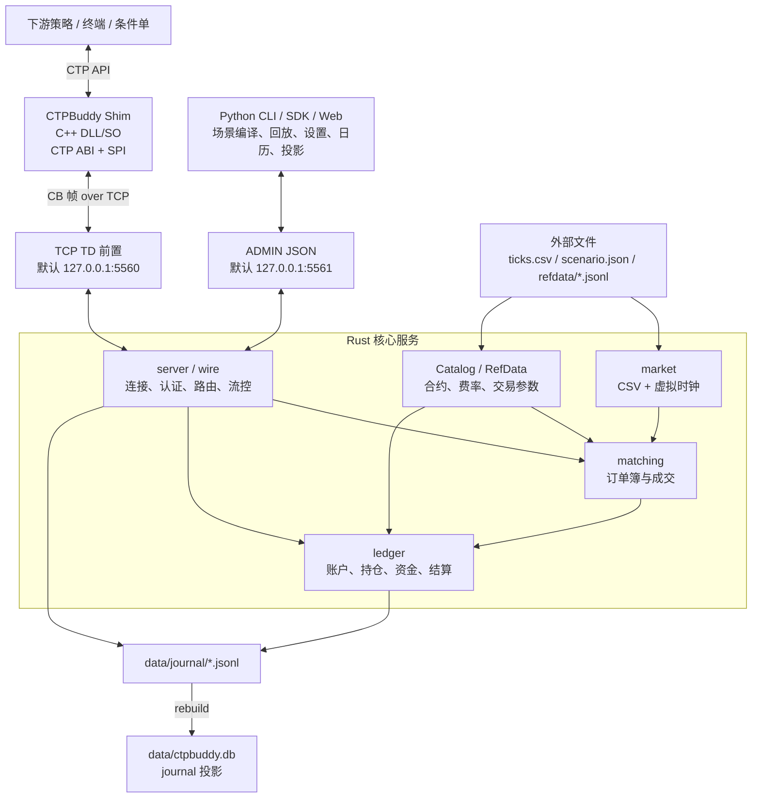

TD 是下游 CTP 应用的数据面，ADMIN 是 Python 控制面；两者使用独立端口。核心默认使用明文 TCP 承载 CB 帧，也支持 Shim 和原生客户端通过 `zmq://` 端点进入 ROUTER/DEALER 适配；设置 `CTPBUDDY_ZMQ_PUB_ADDR` 后可订阅 `md/`、`td/` 与 `sys/` PUB/SUB 广播。Shim 不承载业务逻辑；Rust 核心保持确定性撮合和账户单写者边界；Python 控制面不实现撮合与账本。

完整设计和 ADR 见仓库根 [`DESIGN.md`](https://github.com/charleszu/ctpbuddy/blob/main/DESIGN.md)。
